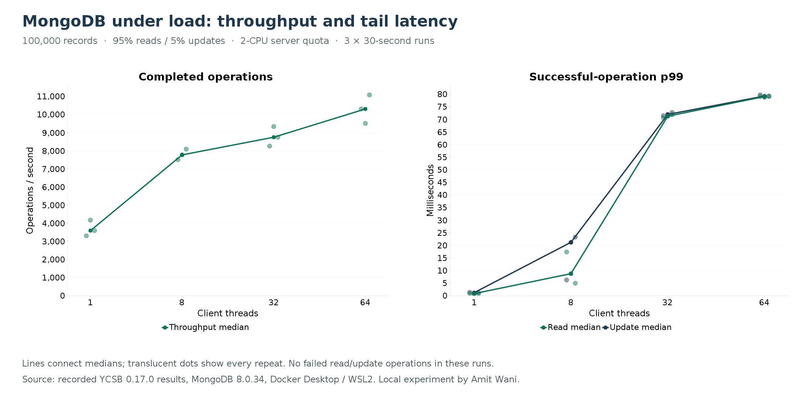

# Recorded results — 2026-10-24

Question: under a fixed small read/update workload, how does client concurrency affect a resource-limited self-hosted MongoDB instance?

## Environment and method

MongoDB 8.0.34; standalone; official image digest in compose.yaml. Server limited to a two-CPU quota and 2 GiB RAM; WiredTiger cache 0.5 GiB. Local generator and server share an Intel Core i5-13500H system running Docker Desktop/WSL2 (16 logical CPUs reported to Docker, roughly 11.5 GiB available). Physical backing storage was not isolated/characterized. Java 21.0.12.1, YCSB core 0.17.0 and original Java driver 3.8.0, exact source/dependency hashes recorded. No current-driver compatibility certification is inferred.

Loaded 100,000 records of ten 100-byte fields plus overhead: 116,788,007 logical BSON bytes, average object size 1,167 bytes. Only _id index. Uniform keys, 95% full-document reads / 5% one-field $set updates by _id. w:1, local read concern, primary reads, retryWrites=false, no explicit j:true. URI and timeout settings recorded per command.

Fresh collection; successful insert-count and collection-count check; 20-second cache warm-up in a separate JVM. Each 30-second measurement launches a fresh JVM and retains JIT/connection-ramp effects and initialization after the YCSB timer starts. Orders: 1/8/32/64, 64/32/8/1, 8/64/1/32. All twelve measurements retained, no selected repeats. Main experiment is uncapped and closed-loop.

## Main results

Values below are medians of three individual run summaries; percentiles are not pooled.

| Threads | ops/s | Read p99 ms | Update p99 ms | Read p99 min–max ms |
| --- | ---: | ---: | ---: | ---: |
| 1 | 3,589.38 | 0.799 | 1.171 | 0.610–0.863 |
| 8 | 7,769.52 | 8.719 | 21.167 | 4.911–17.343 |
| 32 | 8,743.05 | 71.231 | 71.935 | 70.591–71.807 |
| 64 | 10,304.18 | 79.039 | 79.231 | 78.783–79.039 |

There were 2,753,371 measured read/update operations across the main runs. Return=OK matched each operation total, with no non-OK statuses. This is a finite observation, not proof of a zero production error rate.

Increasing from 8 to 32 threads added about 12.5% median throughput and raised median read p99 about 8.17 times. At 8+ threads, container CPU usage averaged about 1.94–1.95 core equivalents against a quota of two; median throttled quota-period fractions exceeded 93%. Snapshot CPU includes diagnostics. Throttling occurrence is evidence of quota pressure; this was not a controlled CPU-quota-change experiment and does not isolate every source of latency.

Captured explain: EXPRESS_IXSCAN on _id_, one key and one document examined, one returned. Explain executionTimeMillis was 0, which is not a client-latency measurement.

## Capped-rate follow-up

Three fresh-JVM runs, eight threads, -target 3000, 30 seconds each, same existing collection/server. Each reported only OK read/update statuses.

- Achieved ops/s median: 2,962.12; range 2,953.75–2,966.41.
- Successful read p99 median: 1.928 ms; range 1.881–2.127 ms.
- Successful update p99 median: 2.599 ms.
- Intended read p99 median: 135.167 ms; range 56.991–148.863 ms.

First capped run: initial five-second status interval achieved 2,779.8 ops/s; next interval achieved 3,000. Intended tail was higher initially. This supports inspecting scheduling/startup effects, not declaring a fixed-arrival application latency requirement met from operation latency alone. YCSB finite workers and its throttle are not an independent unlimited arrival generator.

## Evidence and limits

Raw main results: results/experiment-1/. Follow-up: results/rate-check-3000/. Derived values: results/analysis.json. Exact commands, status logs, per-operation HDR files, generator /usr/bin/time reports and server snapshots retained. JAR/source checksums and plotting source included.

Small warmed data; short runs; historical client; shared host; local network path; uncharacterized disk; standalone topology; no API, replication, failover, transaction, large aggregation, long soak or production SLO test. Results describe this setup and workload. A useful next experiment changes one relevant condition while retaining the same evidence.

The failed first full load's Java 21 histogram-export error is retained in results/attempt-1-jaxb and excluded. JAXB API 2.3.1 fixed the export path before the successful fresh-load experiment.
